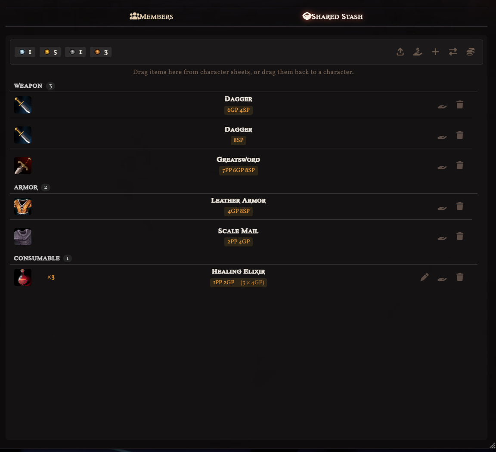

# Crucible Party Stash


A shared party inventory for the [Crucible](https://foundryvtt.com/packages/crucible) game system in [Foundry Virtual Tabletop](https://foundryvtt.com/).

Adds a **Stash** tab to the Group Actor sheet where players can pool items, distribute loot, and manage shared resources — all without leaving the group sheet.



## Features

- **Shared Stash Tab** — A new tab on the Crucible Group Actor sheet for pooling party items, alongside the sheet's own Members and Milestones tabs.
- **Resizable Group Sheet** — The group sheet can be dragged larger from the bottom-right corner, so the stash and members list can use a wide display.
- **Drag & Drop** — Drag items from any character sheet into the stash, or drag them back out to a character.
- **Split on Deposit** — When stashing a stacked item (e.g. 5 Healing Potions), choose how many to stash. The source keeps the remainder.
- **Split on Withdrawal** — When giving or dragging a stashed stack to a character, choose how many to take. Remainder stays in the stash.
- **Auto-Merge** — Stashing an item that matches an existing stash entry (same type, affixes, quality) increments the existing entry's quantity instead of creating a duplicate.
- **Give to Character** — Click the give button to hand an item directly to any party member via a dropdown picker.
- **Capacity Limit** — Set a maximum number of stash slots the stash can hold (0 = unlimited). Merged entries reuse existing slots.
- **Item Type Grouping** — Stash entries are grouped under a heading by item type (Weapon, Armor, Consumable…) rather than repeating the type on every card. Only types that count as inventory produce a heading; anything else is collected into a trailing "Other" group so nothing is hidden.
- **Item Value & Quantity** — Each row shows what the item is worth in Crucible's denomination format, and stack counts sit in their own column beside the icon. A stack shows its total with the unit breakdown, e.g. `1PP 2GP (3 × 4GP)`. Hovering an item shows the same value in the item card tooltip.
- **Sorted Within Groups** — Items are ordered by name (A→Z), then by value (highest first), so identical items sit together and the best of a cluster reads first.
- **Party Currency Pool** — A shared currency pool on the Stash tab with deposit, take, GM create, and GM split flows. All amounts are entered per denomination (pp/gp/sp/cp).
- **Shaped or Shapeless Currency** — Configure the pool as a literal pile of coins (denominations tracked separately, GM exchange to make change) or an abstract purse (freely interchangeable, matching how character currency works).
- **Role-Based Access** — Configure the minimum user role required to see and use the stash. GMs always have access.
- **Stash Resync** — Stash entries are frozen snapshots of the items placed in them. When Crucible updates an item's upstream data, live items update but stash snapshots do not. On first load after a system update, each entry is re-resolved against its compendium source, preserving player state (quantity, quality, equipped, broken, invested, and applied enchantments). Hand-made items with no compendium source are left alone. Runs once, automatically.

## Installation

### From Foundry

1. Open Foundry VTT and go to **Add-on Modules** → **Install Module**.
2. Paste the following URL into the **Manifest URL** field:
   ```
   https://github.com/Ebonhawk3829/crucible-party-stash/releases/latest/download/module.json
   ```
3. Click **Install**.
4. Enable the module in your world.

### Manual

Download `module.zip` from the [latest release](https://github.com/Ebonhawk3829/crucible-party-stash/releases/latest), extract it into your `Data/modules/` directory, and restart Foundry.

## Requirements

| Requirement | Version |
|---|---|
| Foundry VTT | v14+ |
| Crucible | 0.11.2+ |

This module **only** works with the Crucible game system, and requires **Crucible 0.11.2 or newer** — it registers a template part and tab on `CrucibleGroupActorSheet` and will not activate for other systems or older Crucible releases.

## Settings

Configurable under **Settings** → **Module Settings** → **Crucible Party Stash**. All settings are world-scoped except Debug Logging, which is client-scoped.

| Setting | Scope | Default | Description |
|---|---|---|---|
| Stash Capacity | World | 0 (unlimited) | Maximum number of stash slots. Merged entries reuse existing slots. Set to 0 for no limit. |
| Confirm Transfer | World | Enabled | For single items, show a confirmation dialog when moving to the stash. For stacks, a quantity prompt is always shown regardless of this setting. |
| Minimum Role | World | Player | The minimum user role required to see and interact with the stash tab. |
| Shaped Currency Pool | World | Enabled | **ON:** the pool is a literal pile of coins — pp/gp/sp/cp are tracked and spent separately, with no automatic conversion. Use the GM **Exchange** button to make change (e.g. 1pp → 10gp). **OFF:** the pool is an abstract purse — denominations are freely interchangeable and totals display in the largest possible denominations. Switching this setting reshapes the existing pool immediately. |
| Debug Logging | Client | Disabled | Write detailed stash diagnostics to the browser console (F12). Being client-scoped, it can be toggled live without a reload and won't affect other users. |

## Usage

1. **Open a Group Actor sheet** — the module adds a **Shared Stash** tab alongside the sheet's **Members** and **Milestones** tabs.
2. **Add items** — Drag an item from any Hero or Adversary character sheet onto the Stash tab. For stacked items (qty > 1), a dialog lets you choose how many to stash.
3. **Retrieve items** — Either drag an item from the stash onto a character sheet, or click the give button and pick a party member from the list. For stacked items, a dialog lets you choose how many to take.
4. **Auto-merge** — Stashing an item that matches an existing stash entry (same affixes, quality, etc.) automatically increments the existing entry's quantity.
5. **Read the stash** — Items are grouped by type and sorted by name then value. Each row shows the item's value and, for stacks, its count beside the icon. Hover an item for its full card and value.
6. **Edit quantities** — GMs can click the pen control on a stackable entry to set its quantity directly, without depositing and re-withdrawing.
7. **Remove items** — Click the trash icon to delete an item from the stash entirely.

## Compatibility

This module targets Crucible's `CrucibleGroupActorSheet` and uses Foundry V14 APIs including `ApplicationV2`, `DialogV2`, `NumberField` settings, and Handlebars template rendering under the `foundry.applications.handlebars` namespace.

It requires **Crucible 0.11.2 or newer**. From 0.11.2 the group sheet is built from template parts with its own tab group (Members / Milestones); the module registers a `stash` part and a matching `stash` tab on that sheet, so the system's own tab navigation and `ApplicationV2#changeTab` handle showing and hiding the panel. Earlier Crucible releases do not expose that structure and are not supported. The module also opts the group sheet into `ApplicationV2` window resizing (`window.resizable`), which Crucible leaves disabled by default.

It is designed to be non-destructive — stash data is stored as a flag on the Group Actor (`crucible-party-stash.stash`) and does not modify any core Crucible data models.

### Known Interactions

- **Ember** — Compatible. The module does not interfere with Ember's adventure content or Vista engine. Stash data persists independently of adventure imports.

## License

This module is released under the [MIT License](LICENSE).